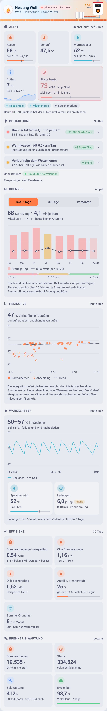
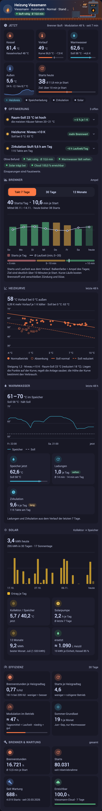
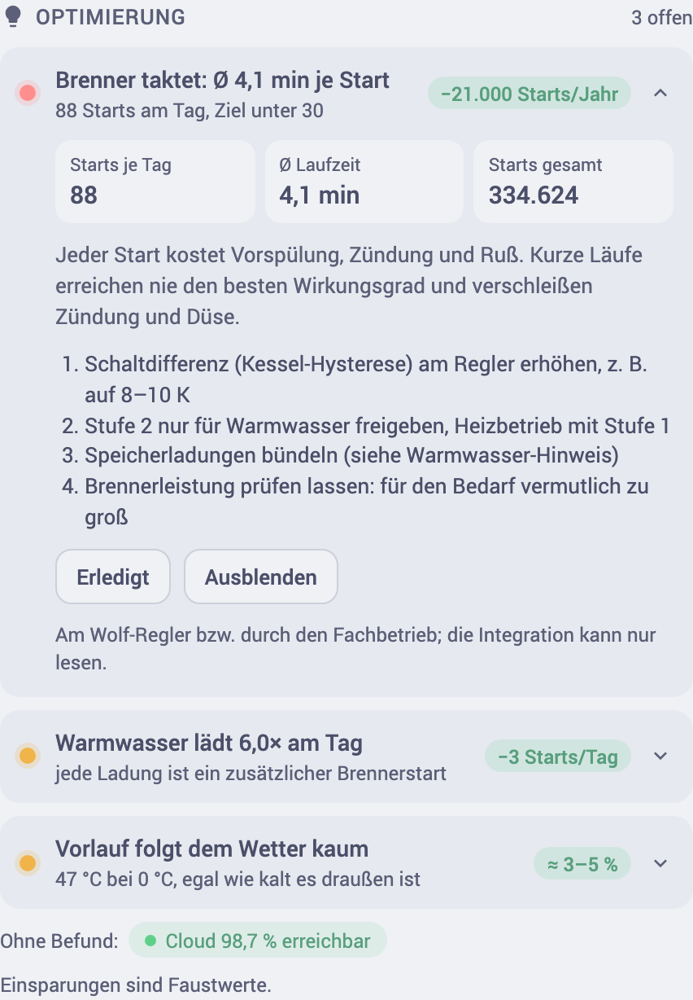
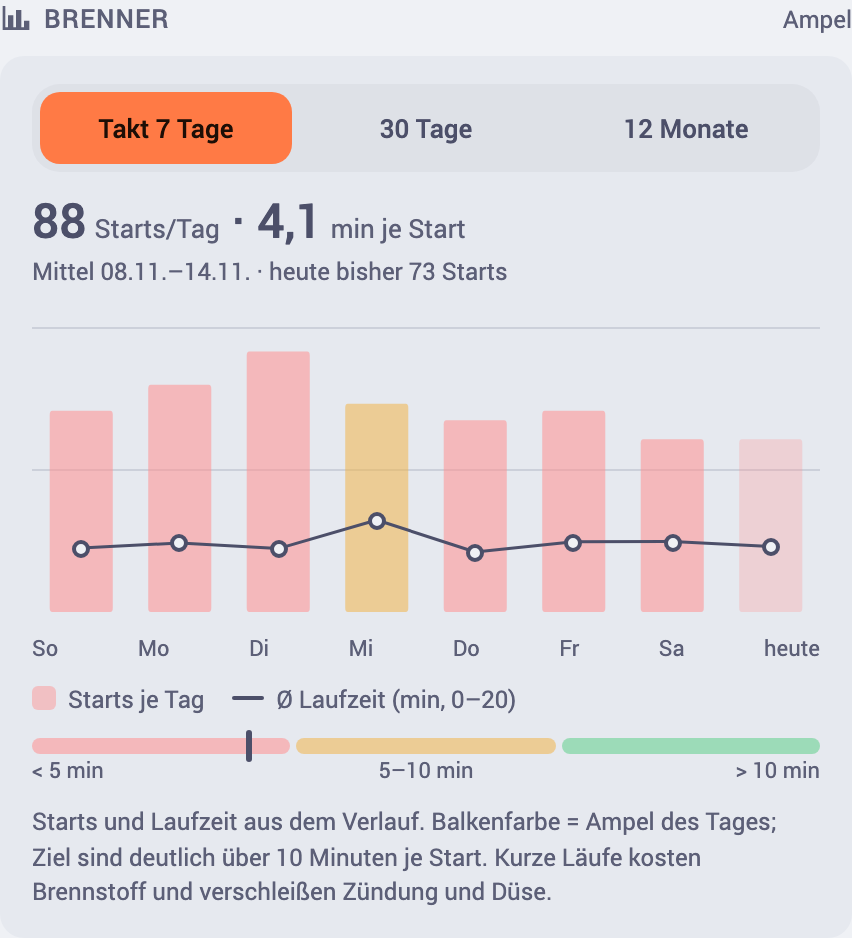
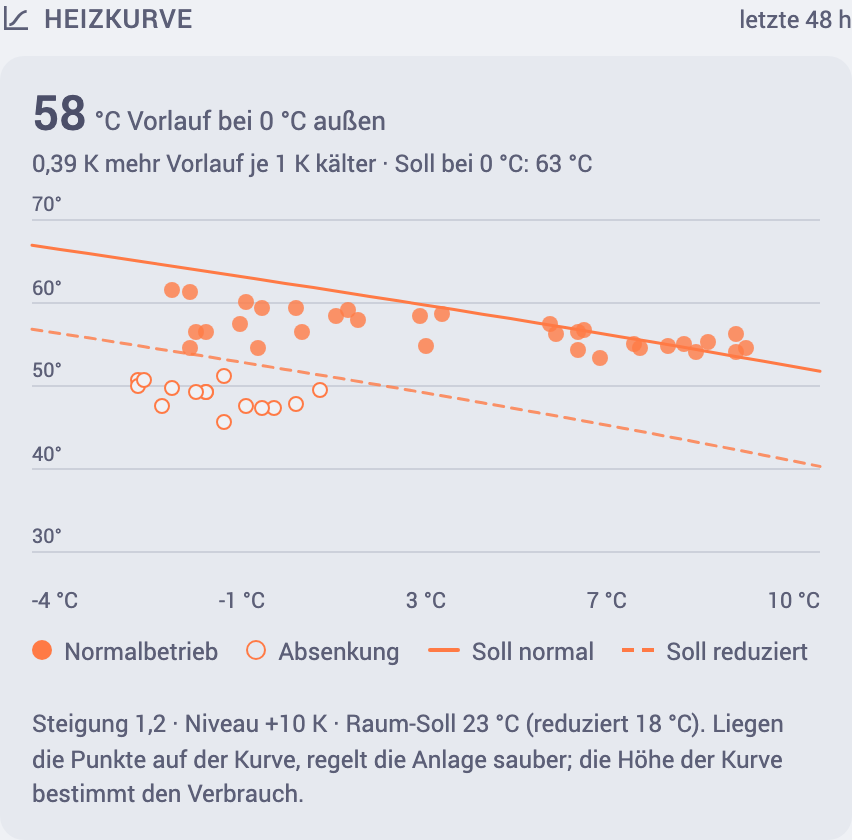
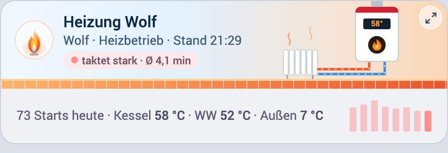

# Central Heating Card

[](https://my.home-assistant.io/redirect/marketplace_repository/?owner=hoentaex&repository=ha-central-heating-card&category=plugin)
[](https://github.com/hoentaex/ha-central-heating-card/releases/latest)
[](https://github.com/hoentaex/ha-central-heating-card/actions/workflows/validate.yml)
[](https://github.com/hoentaex/ha-central-heating-card/actions/workflows/hacs.yml)
[](LICENSE)

**[Deutsch](#deutsch) · [English](#english)**

| Wolf| Viessmann |
|---|---|
|  |  |

---

## Deutsch

Lovelace-Karte für eine **Öl- oder Gas-Zentralheizung**: Brenner mit animierter Flamme, Temperaturen mit Soll-Werten,
Takt-Analyse, Heizkurve, Warmwasser, Solar, Effizienz und **Optimierungs-Hinweise** in einer Karte. Sie findet die
Entitäten der Integrationen [Wolf SmartSet](https://www.home-assistant.io/integrations/wolflink/) (`wolflink`) und
[Viessmann ViCare](https://www.home-assistant.io/integrations/vicare/) (`vicare`) selbst.

Aufbau und Look orientieren sich an den Karten von [juju35](https://github.com/juju35). Schwesterprojekte:
[Oil Overview Card](https://github.com/hoentaex/ha-oil-overview-card),
[Energy Overview Card](https://github.com/hoentaex/ha-energy-overview-card),
[Tibber Battery Card](https://github.com/hoentaex/ha-tibber-battery-card).

> [!WARNING]
> **Privates Hobbyprojekt.** Die Karte ist für meine eigene Installation entstanden und wird in der Freizeit gepflegt.
> Es gibt keine Gewährleistung und keinen Support: **Die Nutzung erfolgt auf eigene Gefahr.**
> Die Karte schaltet nur, wenn du bei einem Optimierungs-Hinweis „Setzen“ bestätigst (`number.set_value`).

### Was die Karte zeigt

- **Kopf:** Flamme, Name, Hersteller · Betriebsart · Programm · Stand. Der Chip zeigt die Takt-Ampel
  („taktet stark · Ø 4,1 min“), solange keine Verbindung besteht „Keine Verbindung“.
- **Jetzt:** Brenner mit animierter Flamme – drei flackernde Schichten, Glühen und Funken; die Höhe folgt der
  Modulation (Viessmann), aus ist nur der Umriss zu sehen. Kacheln für Kessel, Vorlauf, Warmwasser und Außen mit
  Soll-Balken (bei Viessmann das Vorlauf-Soll aus der eingestellten Heizkurve), Pumpen als Chips, Raumtemperatur mit
  Plausibilitätsprüfung (ein Fühler am Kessel wird durchgestrichen).
- **Optimierung:** Hinweise aus festen Regeln – Takten, Warmwasser-Ladungen, Witterungsführung, Raum-Soll, Niveau der
  Heizkurve, Zirkulation, Heizen bei Sommerwetter. Jeder Hinweis zeigt die auslösenden Zahlen, warum es sich lohnt,
  konkrete Schritte und eine grobe Einsparung (Faustwerte). Wo die Integration den Wert schreiben kann
  (Viessmann-`number`-Entitäten), setzt ein Knopf ihn nach einer Rückfrage. **Erledigt** merkt sich das Datum und
  vergleicht danach Brennerstunden je Heizgradtag vorher/nachher, **Ausblenden** schaltet einen Hinweis stumm. Beides
  liegt in den Benutzerdaten von Home Assistant und ist damit auf allen Geräten gleich.
- **Brenner** in drei Ansichten, mit Finger oder Maus abfahrbar:
  - **Takt 7 Tage:** Starts je Tag und Ø Laufzeit je Start aus dem Verlauf (minutengenau), Balken in Ampelfarben
    (unter 5 min rot, 5–10 min gelb, darüber grün). Starts kommen vom Startzähler oder – ohne Zähler – aus den
    Wechseln aus → an.
  - **30 Tage:** Brennerstunden je Tag mit Außentemperatur, Stunden je Heizgradtag.
  - **12 Monate:** Brennerstunden je Monat neben dem Vorjahresmonat, mit Starts und Laufzeit je Start.
- **Heizkurve** (letzte 48 h): Vorlauf über Außentemperatur aus Stundenmitteln, Normalbetrieb als Punkte, Absenkung
  oder Warmwasser-Vorrang als Ringe (aus den Daten erkannt), Trend mit „°C Vorlauf bei 0 °C“ und „K je 1 K kälter“.
  Bei Viessmann zusätzlich die eingestellten Soll-Kurven (normal und reduziert).
- **Warmwasser** (letzte 48 h): Speichertemperatur gegen Soll, Ladungen je Tag mit Dauer, Zirkulationsstunden je Tag.
- **Solar** (nur Viessmann): Ertrag je Tag über 30 Tage, Kollektor und Speicher, Laufzeit der Solarpumpe, Ertrag der
  letzten 12 Monate mit bestem Monat und dem ersetzten Brennstoff.
- **Effizienz** (30 Tage): Brennerstunden und Starts je Heizgradtag, Anteil der 2. Brennerstufe (Wolf), Modulation im
  Betrieb (Viessmann), Brennstoff je Brennerstunde und je Heizgradtag (mit `fuel_entity`), Sommer-Grundlast.
- **Fußzeile:** Brennerstunden und Starts mit Ø Laufzeit je Start, Stunden und Starts seit der letzten Wartung
  (`maintenance_date`), Erreichbarkeit der Hersteller-Cloud über 7 Tage.
- **Illustrierter Kopf** (90 px, wie die neuen Karten von juju35): Titel, Takt-Pill und Untertitel auf dem Himmel,
  rechts die Therme (Wolf mit rotem Kopf, sonst neutral) mit Kesseltemperatur im Display, Flamme im Brennerfenster
  solange der Brenner läuft, Vor- und Rücklauf zum Heizkörper mit aufsteigender Wärme und der Vorlauf als Anzeige.
  Bodenstreifen orange = Heizbetrieb, blau = Speicherladung, grau = aus. Nachtbild mit dem dunklen Theme.
- **Mini-Karte:** derselbe Kopf, darunter Starts heute, Kessel, Warmwasser, Außentemperatur und ein
  kleines Balkendiagramm der Starts. Der Knopf öffnet die große Karte als Popup (oder klappt sie auf).

| Optimierung | Takt 7 Tage | Heizkurve |
|---|---|---|
|  |  |  |



### Voraussetzungen

- Home Assistant 2024.8 oder neuer, Recorder aktiv (Standard).
- Eine der Integrationen **Wolf SmartSet** oder **Viessmann ViCare** – oder beliebige eigene Entitäten unter `entities:`.
- Der **Takt** braucht den Verlauf des Brenners (Recorder hält ihn standardmäßig 10 Tage), **30 Tage / 12 Monate**,
  **Heizkurve**, **Warmwasser** und **Effizienz** die Langzeitstatistik (`state_class`) der jeweiligen Sensoren.
  Wolfs Brennerstarts haben keine `state_class`: Der Takt funktioniert trotzdem, Starts je Monat fehlen.

### Installation

**HACS:** über den Marketplace-Button oben (benutzerdefiniertes Repository, Typ *Dashboard*), dann „Central Heating
Card“ installieren und den Browser neu laden.

**Manuell:** `ha-central-heating-card.js` aus dem [neuesten Release](https://github.com/hoentaex/ha-central-heating-card/releases/latest)
nach `config/www/` kopieren und als Dashboard-Ressource `/local/ha-central-heating-card.js` (JavaScript-Modul) eintragen.

### Konfiguration

Alles lässt sich im visuellen Editor einstellen. Minimal:

```yaml
type: custom:central-heating-card
name: Heizung Wolf
```

Vollständig:

```yaml
type: custom:central-heating-card
preset: auto            # auto | wolflink | vicare
name: Heizung Wolf
outdoor_entity: sensor.wetter_aussentemperatur   # optional, ersetzt den Außenfühler der Heizung
entities:               # optional: einzelne Rollen überschreiben ("" blendet sie aus)
  room_temp: ""
hide: [room]            # optional: boiler, flow, dhw, outdoor, room, pumps
sections: [header, now, tips, burner, curve, dhw, solar, efficiency, footer]
default_view: takt      # takt | days | months
heating_base_temp: 15   # Heizgrenze für Heizgradtage
takt_warn_min: 5        # Ampel: rot unter 5 min je Start
takt_good_min: 10       # Ampel: grün ab 10 min je Start
fuel: oil               # oil | gas
fuel_entity: sensor.heizol_verbrauch_gesamt     # optional, Zähler in L bzw. m³ (total_increasing)
kwh_per_unit: 10        # Energie je L bzw. m³ (für „ersetzt“ beim Solar)
boiler_efficiency: 0.85
maintenance_date: "2026-04-15"   # optional, letzte Wartung
animations: true
illustration: true      # false: schlichter Kopf, Flamme wieder im Abschnitt „Jetzt“
illustration_theme: night   # optional: day | night, sonst wie das Theme
language: de            # optional, sonst die Sprache von Home Assistant
```

```yaml
type: custom:central-heating-mini-card
name: Heizung Viessmann
popup: true             # false: große Karte unter der Zeile aufklappen
```

**Rollen** unter `entities:` (alle automatisch erkannt, einzeln überschreibbar): `burner`, `modulation`,
`boiler_temp`, `boiler_target`, `boiler_supply`, `flow_temp`, `dhw_temp`, `dhw_target`, `outdoor`, `room_temp`,
`room_target`, `mode`, `pump_boiler`, `pump_heating`, `pump_mixer`, `pump_dhw_charge`, `pump_dhw_circ`, `pump_solar`,
`curve_slope`, `curve_shift`, `normal_temp`, `reduced_temp`, `comfort_temp`, `burner_hours`, `burner_hours_2`,
`burner_starts`, `solar_collector`, `solar_storage`, `solar_today`.

**Farben** über das Theme: `--chc-heat-color`, `--chc-water-color`, `--chc-good-color`, `--chc-mid-color`,
`--chc-warn-color`, `--chc-temp-color`, `--chc-solar-color`.

### Entwicklung

```bash
npm install
npm run demo          # http://127.0.0.1:8772/demo/ – Wolf und Viessmann mit echten Werten
npm test
npm run check
npm run screenshots   # PORT=… falls 8772 belegt ist
```

---

## English

Lovelace card for an **oil or gas central heating**: burner with an animated flame, temperatures with targets,
cycling analysis, heating curve, hot water, solar, efficiency and **optimisation tips** in one card. It finds the
entities of the Wolf SmartSet (`wolflink`) and Viessmann ViCare (`vicare`) integrations by itself; every role can be
overridden under `entities:`.

> [!WARNING]
> **Private hobby project**, no warranty, no support: **use at your own risk.** The card only switches something when
> you confirm "Set" on an optimisation tip (`number.set_value`).

- **Now:** burner with an animated flame (height follows the modulation), boiler / flow / hot-water / outdoor tiles with
  targets (ViCare flow target from the heating curve), pumps, plausibility check of the room temperature.
- **Optimisation:** rule-based tips (short cycling, hot-water charges, weather compensation, room target, curve level,
  circulation, heating in summer) with evidence, reasons, steps and a rough saving; a button sets ViCare number entities
  after a confirmation; done / hidden is kept in Home Assistant's per-user data, done tips compare before and after.
- **Burner:** cycling over 7 days from the history with a red/amber/green rating, 30 days of burner hours with the
  outdoor temperature, 13 months next to the previous year.
- **Heating curve** and **hot water** over 48 hours, **solar** (ViCare), **efficiency** over 30 days, **footer** with
  counters, hours since the last service and how reachable the cloud was.
- **Mini card:** one row with flame, rating, starts today and temperatures; opens the main card as a popup.

Install via HACS (custom repository, type *Dashboard*) or copy `ha-central-heating-card.js` to `config/www/`.
All options are in the visual editor and in the German section above.

MIT licence.
